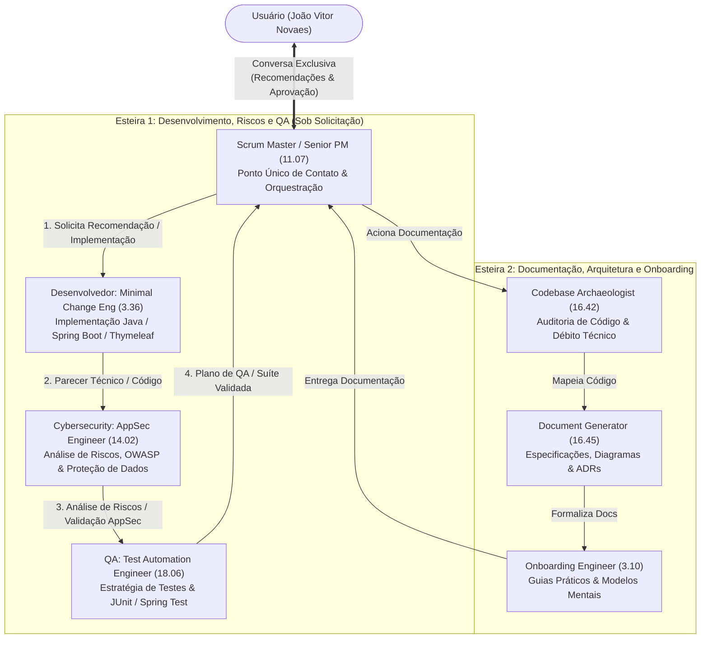
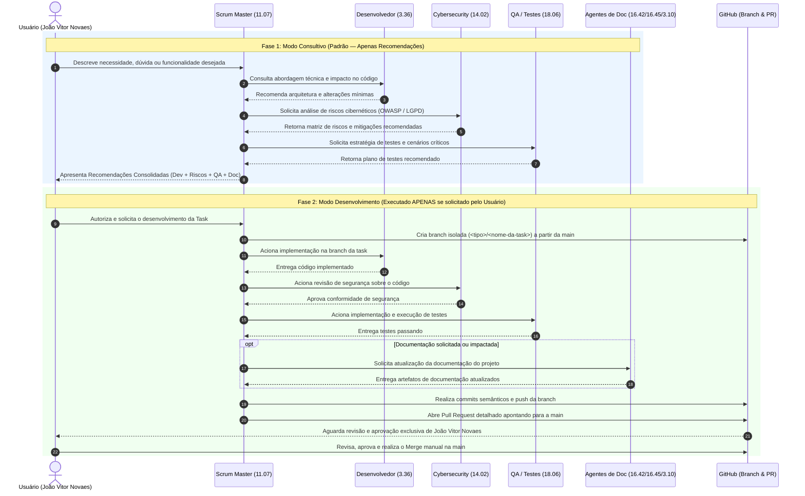
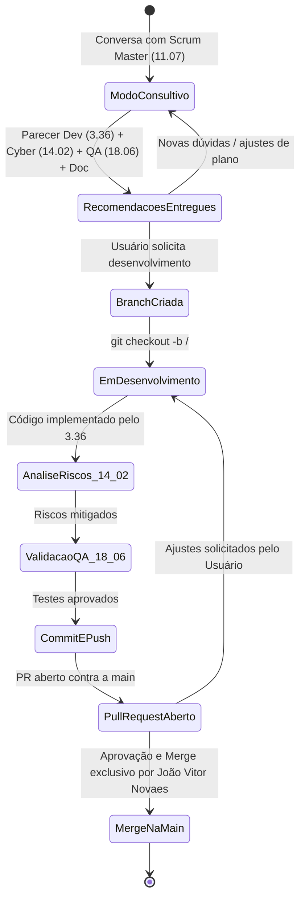

# Fluxo de Desenvolvimento no GitHub e Governança do Scrum Master (11.07): PulseAI-Concent

Este documento especifica as regras de governança, o modelo consultivo de recomendações, o fluxo de branches e Pull Requests no GitHub e a arquitetura das duas esteiras de agentes (7 especialistas instalados via `ai-agents-core` em `.squad/`).

---

## 1. Regras de Negócio e Governança Obrigatória

1. **Interação Exclusiva via Scrum Master (`11.07` Senior Project Manager)**:
   - O usuário (**João Vitor Novaes** / `@novaes11`) conversa exclusivamente com o **Senior Project Manager (`11.07` - `project-manager-senior`)**, que atua como **Scrum Master** do projeto.
   - Os demais 6 agentes (`3.36`, `14.02`, `18.06`, `16.42`, `16.45` e `3.10`) não interagem diretamente com o usuário; eles são acionados internamente pelo Scrum Master para fornecer insumos técnicos, análises de risco, testes e documentação.
2. **Foco em Recomendações e Desenvolvimento Estritamente sob Demanda**:
   - O propósito primário do esquadrão é **apoiar o usuário com recomendações arquiteturais, análise de riscos cibernéticos, qualidade de testes e documentação**.
   - Os agentes **apenas desenvolvem ou modificam arquivos caso o usuário solicite explicitamente**. Sem autorização explícita para codificar, o Scrum Master limita-se a analisar e recomendar.
3. **Fluxo de Desenvolvimento Git, Proteção da `main` e Aprovação Exclusiva do Usuário**:
   - É estritamente proibido commitar ou fazer push diretamente na branch `main` (protegida por GitHub Ruleset e por Git Hooks locais em `.githooks/`).
   - Quando autorizado o desenvolvimento de uma task, o fluxo obrigatório é:
     1. Criar uma branch nova a partir da `main` nomeada conforme a task: `feat/<nome-da-task>`, `fix/<nome-da-task>`, `refactor/<nome-da-task>`, `test/<nome-da-task>`, `docs/<nome-da-task>` ou `chore/<nome-da-task>`.
     2. Implementar o código, validar riscos com Cybersecurity (`14.02`) e validar testes com QA (`18.06`).
     3. Realizar commits semânticos (*Conventional Commits*) na branch da task.
     4. Fazer push da branch e abrir o Pull Request para a `main`.
     5. **Apenas João Vitor Novaes (`@novaes11`) possui autoridade para revisar, aprovar e realizar o merge do Pull Request.**

---

## 2. Diagrama Oficial das Duas Esteiras de Agentes

### Catálogo de Agentes do Projeto (`.squad/squad-config.yml`)

| Código | Slug no Catálogo | Papel no Projeto | Esteira |
| :--- | :--- | :--- | :--- |
| `11.07` | `project-manager-senior` | **Scrum Master** — Ponto Único de Contato, Recomendações e Gestão de Tasks | Orquestrador |
| `3.36` | `engineering-minimal-change-engineer` | **Desenvolvedor** — Recomendações de Implementação e Código Modular | Esteira 1 |
| `14.02` | `security-appsec-engineer` | **Cybersecurity** — Análise de Riscos, Threat Modeling e Auditoria OWASP | Esteira 1 |
| `18.06` | `testing-test-automation-engineer` | **QA** — Planejamento de Testes, Casos de Borda e Automação JUnit | Esteira 1 |
| `16.42` | `specialized-codebase-archaeologist` | **Documentação (Auditoria)** — Mapeamento de Código e Débito Técnico | Esteira 2 |
| `16.45` | `specialized-document-generator` | **Documentação (Specs)** — Relatórios Executivos, UML/Mermaid e ADRs | Esteira 2 |
| `3.10` | `engineering-codebase-onboarding-engineer` | **Documentação (Onboarding)** — Guias Práticos e Arquitetura para Devs | Esteira 2 |

---

## 3. Diagrama de Sequência UML: Consultoria vs. Desenvolvimento sob Demanda

---

## 4. Ciclo de Vida de Branches e Proteção da `main`

### Camadas de Proteção Ativas na Branch `main`
1. **GitHub Repository Ruleset (`Main Protection`)**:
   - Bloqueia exclusão da branch `main` (`deletion`).
   - Bloqueia *force push* (`non_fast_forward`).
   - Exige abertura de **Pull Request** para qualquer alteração na `main` (`pull_request`), com resolução obrigatória de threads de revisão (`required_review_thread_resolution: true`) e sem lista de *bypass* (`bypass_actors: []`).
2. **Git Hooks Locais (`.githooks/`)**:
   - `pre-push`: Impede qualquer `git push` direto para `refs/heads/main`.
   - `pre-commit`: Impede o commit de arquivos `.env` e o vazamento acidental de chaves, tokens ou segredos hardcoded.
